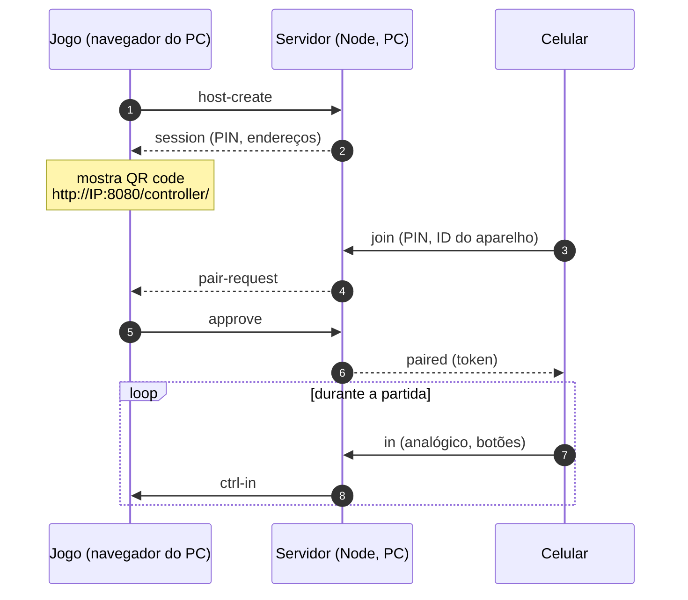

<div align="center">


# TRS · Controle no celular

**Transforme o celular em controle do [Traficas Revolution Soccer](https://github.com/Traficas-Revolution-Soccer/game-trs).**<br/>
Leia o QR code, autorize no computador e jogue. Sem app, sem instalação, sem dependências.

[](https://github.com/Traficas-Revolution-Soccer/trs-mobile-device-management/actions/workflows/test.yml)


</div>

---

## Sumário

- [O que é](#o-que-é)
- [Início rápido](#início-rápido)
- [Como funciona](#como-funciona)
- [Estrutura do projeto](#estrutura-do-projeto)
- [Segurança](#segurança)
- [Latência](#latência)
- [Tela cheia e horizontal](#tela-cheia-e-horizontal)
- [Configuração](#configuração)
- [Desenvolvimento](#desenvolvimento)
- [Roadmap](#roadmap)
- [Licença](#licença)

## O que é

O celular vira um controle de verdade para o jogo, que roda no navegador do computador:

- **Pareamento por QR code**: a câmera abre o controle já com o PIN, sem digitar nada.
- **Analógico e botões com multitoque**: segurar o analógico, correr e passar ao mesmo tempo.
- **Baixa latência**: botões enviados no próprio evento de toque, e toques curtos nunca se perdem.
- **Seguro na rede local**: PIN temporário, autorização no computador, um pedido por aparelho e token de reconexão.
- **Até 4 celulares** por partida, cada um como um controle independente.
- **Sem dependências**: só Node.js e JavaScript puro no navegador.

O celular **só envia comandos**. Nenhuma imagem da partida passa pela rede.

## Início rápido

**Requisitos:** Node.js 18 ou mais novo, com o celular e o computador na mesma rede Wi-Fi.

```bash
# os dois repos lado a lado
git clone https://github.com/Traficas-Revolution-Soccer/game-trs.git
git clone https://github.com/Traficas-Revolution-Soccer/trs-mobile-device-management.git

cd trs-mobile-device-management
node server/server.js --game ../game-trs
```

1. No **computador**, abra o endereço que o servidor mostra (por exemplo `http://192.168.0.10:8080/`).
2. No jogo, vá em **Menu → Controle virtual → CRIAR SESSÃO**. Aparecem um QR code e um PIN, válidos por 10 minutos.
3. No **celular**, aponte a câmera para o QR code. Sem câmera, abra `http://IP-DO-PC:8080/controller/` e digite o PIN.
4. Autorize o celular no computador. Pronto: o controle aparece deitado e pede tela cheia no primeiro toque.

> **O celular não abre a página?** Confira se o firewall do Windows libera a porta do Node para redes privadas. Se o computador tiver várias redes, escolha na tela do jogo o endereço da sua rede Wi-Fi: o QR code muda junto.

## Como funciona



- O **servidor** roda no computador, na rede local. Ele serve o jogo (`/`), a página do controle (`/controller/`) e o cliente do jogo (`/mobile/`). Também faz o pareamento e repassa os comandos por WebSocket (`/ws`). Ele **não roda a partida**.
- No **jogo**, cada celular vira um dispositivo de entrada igual a um controle físico. A lógica de futebol nunca sabe que existe rede.
- O protocolo completo está em [docs/PROTOCOL.md](docs/PROTOCOL.md).

## Estrutura do projeto

```
trs-mobile-device-management/
├── client/            # carregado pelo jogo, servido em /mobile/
│   ├── remote.js      # MD.Remote: sessão, autorização, celulares → MD.Input, link e QR de pareamento
│   └── qr.js          # MD.QR: gerador de QR code (byte, nível M, versões 1–10)
├── controller/        # página do celular, servida em /controller/
│   ├── index.html
│   ├── controller.js  # multitoque, envio, pareamento, tela cheia/horizontal
│   └── controller.css
├── server/
│   └── server.js      # HTTP estático + WebSocket (RFC 6455) + sessões
├── tests/             # testes sem dependências (node:assert)
└── docs/PROTOCOL.md   # mensagens do WebSocket
```

O jogo ([game-trs](https://github.com/Traficas-Revolution-Soccer/game-trs)) carrega `mobile/qr.js` e `mobile/remote.js`. Aberto como arquivo (`file://`) ou no HTML offline, eles não existem, e a tela de controle virtual explica como iniciar o servidor.

## Segurança

| Proteção | Como |
|---|---|
| PIN temporário | 6 dígitos, expira em 10 min. Vai no fragmento do link (`#pin=…`), que o navegador não envia ao servidor, e é apagado da barra de endereço ao ser lido |
| Força bruta | 5 PINs errados em 1 minuto bloqueiam o IP por 2 minutos |
| Autorização | O computador aprova cada celular. Nenhum comando chega ao jogo antes disso |
| Um pedido por aparelho | Recarregar, ler o QR de novo ou apertar CONECTAR reaproveita o mesmo pedido. O aparelho é reconhecido por um ID aleatório e, se os dados do navegador forem apagados, pelo IP |
| Recusa definitiva | Um celular recusado não pede de novo naquela sessão, nem trocando o ID. Só um NOVO PIN libera |
| Reconexão | Token por aparelho. Um aparelho já autorizado volta sem pedir de novo |
| Pacotes | Validação de tipos e faixas, numeração crescente (descarta velhos e repetidos), limite de 90 pacotes/s e de 4 KB por mensagem |
| IP real | Vem do socket. `X-Forwarded-For` só é aceito com `TRS_TRUST_PROXY=1` |
| Arquivos | Não serve pastas `server/`, arquivos ocultos nem caminhos fora das pastas montadas |

Encontrou uma falha? Veja [SECURITY.md](SECURITY.md).

## Latência

- **Botões:** apertar e soltar são enviados na hora, no próprio evento de toque.
- **Analógico:** até ~60 pacotes/s, mais um sinal de vida a cada 100 ms.
- **No jogo:** um toque que aperta e solta entre dois quadros não se perde. Acontece quando o Wi-Fi entrega pacotes agrupados.
- **Medição:** o celular mostra o RTT (ida e volta) na barra superior, e o computador mostra o RTT de cada controle.

Na rede local, o caminho é celular → roteador → computador, com um único salto de Wi-Fi.

## Tela cheia e horizontal

- **Tela cheia:** o navegador só permite tela cheia (e só em tela cheia permite travar a orientação) logo depois de um toque. Por isso o controle pede no toque de CONECTAR ou, vindo do QR code, no primeiro toque na tela.
- **Celular em pé:** o controle aparece **girado 90° na hora**, sem precisar de toque, e o analógico é convertido para o eixo certo. Isso também funciona no iPhone, que não tem tela cheia para páginas.
- Dá para desligar em **⚙ → Tela cheia e horizontal automáticas**.

## Configuração

```bash
node server/server.js [porta] [--game PASTA]
```

| Opção | Padrão | Descrição |
|---|---|---|
| `porta` / `PORT` | `8080` | Porta HTTP e WebSocket |
| `--game` / `TRS_GAME_DIR` | `../game-trs`, se existir | Pasta do jogo (precisa ter `index.html`) |
| `TRS_TRUST_PROXY=1` | desligado | Aceitar `X-Forwarded-For`. Use só atrás de um proxy confiável |
| `TRS_QUIET=1` | desligado | Sem log no terminal |

Se o computador tiver várias redes, o servidor lista primeiro o endereço com mais cara de Wi-Fi: `192.168.x`, depois `10.x`, e os adaptadores virtuais (WSL, Hyper-V, Docker) por último.

## Desenvolvimento

```bash
npm test     # requer Node.js 22+ (os testes usam o WebSocket nativo do Node)
npm start    # mesmo que node server/server.js
```

| Teste | O que cobre |
|---|---|
| `tests/qr.test.cjs` | Estrutura do QR pela norma ISO/IEC 18004 (localizadores, temporização, formato BCH, versão) e matrizes de referência |
| `tests/server.test.cjs` | Servidor real (processo Node + WebSocket) com um jogo falso: PIN, bloqueio, autorização, um pedido por aparelho, recusa, token, pacotes, limite, reconexão, rotas e travessia de diretório |

As matrizes de referência do QR, todas as versões de 1 a 10 e as 8 máscaras foram conferidas com o decodificador [jsQR](https://github.com/cozmo/jsQR), inclusive com módulos trocados.

> **Ainda não testado em celulares físicos.** Os testes de navegador usaram páginas móveis emuladas. Tela cheia e trava de orientação dependem do aparelho.

Quer contribuir? Veja [CONTRIBUTING.md](CONTRIBUTING.md).

## Roadmap

- [x] Controle virtual com multitoque e vibração
- [x] Pareamento por PIN com autorização e reconexão
- [x] QR code
- [x] Um pedido por aparelho e recusa por sessão
- [x] Tela cheia e horizontal automáticas
- [ ] Teste e ajuste em celulares físicos (Android e iPhone)
- [ ] Conexão pela internet: WebRTC DataChannel P2P com sinalização na nuvem, TURN como reserva
- [ ] Pacote binário compacto em vez de JSON
- [ ] Medição de jitter (p50/p99) na tela de controle virtual

## Licença

[MIT](LICENSE) © 2026 Traficas Revolution Soccer
